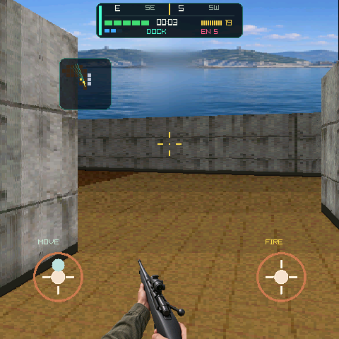

# Last Zone: Extraction

Last Zone 是轻量战术射击游戏。玩家依次完成五个训练任务，搜索补给、清除敌人并抵达
撤离点。任务越靠后，弹药和护甲越少，精英敌人越多。



上图为 Dock 任务的 Host RGB565 画面。

## 玩法与操作

### 真机

- 点击简报部署或重新部署。
- 左摇杆移动，推到外环前方可冲刺。
- 右侧拖动控制转向和俯仰。
- 点击射击键开火或打开面对的门；按住射击可稳住枪机。
- 雷达面板可以拖动，避免遮挡战场。

### Host

- `W`/`S`：前进和后退；`Q`/`E`：横移。
- `A`/`D`：转向；`Shift`：冲刺。
- `F` 或 `Ctrl`：射击或交互。
- 鼠标右侧拖动：调整视角。

## 战役

| 任务 | 定位 | 敌人 |
| --- | --- | ---: |
| Dock | 观察教学 | 5 |
| Depot | 区域控制 | 7 |
| Command | 侧翼突破 | 8，含 2 名精英 |
| Ghost | 伏击 | 8 |
| Run | 强攻 | 9，含 3 名精英 |

设备 NVS 保存战役进度和各任务最好成绩。

## Host 预览

在仓库根目录运行：

```sh
python3 tools/game_cli.py sim examples/last_zone_extraction
```

## 实现特点

Host 与真机共用固定步长模型、透视场景和 RGB565 视图。玩法包括掩体、窗洞、门、弹药、
护甲、精英敌人和撤离判定；音效与震动由语义事件驱动。

## Native 构建

构建目标和 Board 选择见[构建路径](../../docs/build-matrix.CN.md)。直接烧录独立工程会替换
设备当前固件；测试和设备验收流程见[游戏开发指南](../../docs/game-development.CN.md)。
