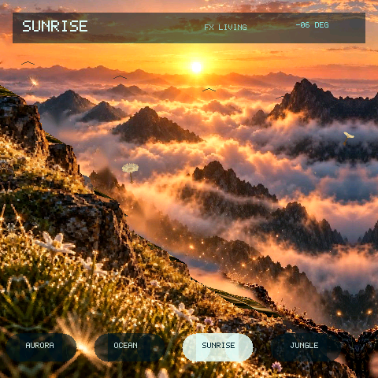

# Living Worlds

[简体中文](README.CN.md) · [Examples](../README.md)

Living Worlds is a four-scene 360° look-around experience. Browse Aurora, Ocean, Sunrise and Jungle; about three seconds after you stop interacting, the automatic tour resumes.



The image is a device capture of the Sunrise scene.

## Play and controls

### Device

- Drag horizontally to turn and vertically to look up or down.
- The bottom buttons switch between the four scenes.
- The top FX button cycles the `Living`, `Mid` and `Low` effect levels.

### Host

Mouse drags follow the same view rules as device touch, and the scene and FX buttons are clickable.

## Host preview

From the repository root:

```sh
python3 tools/game_cli.py sim examples/living_worlds
```

## Implementation

Scenes draw perspective ground, volume meshes and lighting through a deterministic 2.5D RGB565 path, without OpenGL, Camera3D or shaders. Host and device share the world model and view; device JPEG decoding stays in the native implementation (S31 hardware JPEG engine, ESP32-S3 ROM TJpgDec).

## Native build

See [build paths](../../docs/build-matrix.EN.md) for targets and Board selection. Historical device records live in the repository under `docs/development/living-worlds/` (not shipped in the release package) and are not current performance claims.
