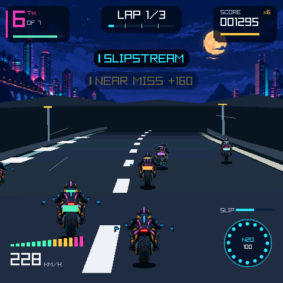

# Neon Rift Rally

[简体中文](README.CN.md) · [Examples](../README.md)

Neon Rift Rally is a third-person neon motorcycle racer. Each of three courses runs a three-lap race against six rivals using sprint, defend and chase strategies. Use drafting, nitro and drifts to fight for position.



The image is a Host RGB565 frame on Neon Loop: a slipstream banner, speedometer, nitro button and rolling score.

## Play and controls

### Device

- Tap the top-left `TOUCH >` / `TILT >` / `KEYS >` control to cycle modes. TOUCH is the default; restarting retains the selected mode.
- TOUCH uses left-side drag steering. TILT uses device tilt with temporary touch takeover. A second finger can hold the bottom-right nitro area.
- TILT calibrates during countdown. Hold the device comfortably and tap `CENTER` to recenter during a race. TOUCH and KEYS ignore tilt steering.
- During the countdown, tap either side of the course name to change course.
- TOUCH and TILT auto-accelerate on both Host and device; KEYS accelerates only while the throttle action is held. After the race, tap the result screen to restart.
- Above speed 18, holding a hard turn for about 0.27 s starts a drift; straightening out cashes it in as a short boost. Leaving the track, a collision or being airborne cancels the charge. Brief corrections do not start a drift.

### Host

- Select KEYS first: `A`/`D` steer, `W` is throttle and `S` is brake.
- `Space`: nitro; `Shift`: drift.
- `P`: pause or resume; `Enter`: restart.
- In TOUCH / TILT, mouse drags on the left and the bottom-right nitro area follow the device touch rules.
- Replay actions `10` / `11` / `12` select TOUCH / TILT / KEYS; `13` recenters. State output includes `control_mode` and `auto_throttle`. Keyboard scenarios should declare action `12` first.

## Race systems

- The bike has five lean poses (hard left, light left, center, light right, hard right) and passes through center when reversing.
- The six riders (VOLT, NOVA, JADE, BLAZE, ORCHID, FROST) have limited launch acceleration and a tighter starting grid. They slow behind an occupied lane and change lanes smoothly to overtake when there is room. Sprinters are faster on straights, defenders block the player's lane when the player is just behind and not closing fast, and chasers close toward the player's lane.
- Every race rolls new personalities from a seed: skill, cornering, aggression and nitro reserve differ per rider, so the order and the fights change between races. Riders take the inside line through bends, check their mirror before merging, slipstream each other, and fire nitro on straights, after being passed or on the final lap. Weak cornerers sometimes slide wide in a bend, which opens a gap. Riders far behind catch up a little so the pack stays in reach.
- One rider per race is the rival: more skilled, more aggressive and with a full nitro tank. It pushes hard when it falls behind the player. A diamond and its name mark it on the road; a HUD panel under the position shows its place and gap, and the results screen says whether you beat it.
- A rider on nitro shows a flame, a sliding rider wobbles and throws sparks, and every bike has a tail light. Nearby boosts and slides pop up as banners ("NOVA BOOSTS", "VOLT SLIPS GO!"); rival boosts have their own sound cue.
- Rival bikes and roadside sprites scale and sort by actual camera depth, grow continuously as they approach and clip naturally as they leave; helmets and back panels help tell riders apart.
- Neon Loop (harbor), Sunset Sprint (canyon) and Polar Rift (snow) have their own vistas and roadside objects; corner signs flip by direction. Ground shadows, drift sparks and a field of view that widens slightly with speed provide driving feedback.
- The harbor course follows a closed hand-authored spline through the port, a warehouse corner and a bridge. Continuous rails, evenly spaced lamp posts, warehouse fronts and bridge trusses share road coordinates; crests can hide objects behind them. Vistas on all three courses are limited to the top 184 rows and curbs are narrower, leaving room for the road and near scenery.
- Canyon sections are framed by continuous rock walls, low barriers and grouped pillars; snow sections use snowbanks, roadside fences and posts. Snow corners are gentler so the wide road does not overlap itself in tight turns.
- Following a rider closely and aligned builds draft; a full meter grants a short speed bonus.
- The HUD shows position with hull integrity (top left), lap and lap progress with checkpoint ticks (top center), a rolling score with the combo timer (top right), a segmented speedometer (bottom left) and a nitro button whose ring of pips shows the charge (bottom right, over the nitro touch zone). A slipstream bar appears while drafting.
- Overtakes, being overtaken, slipstream, near misses, drift boosts, checkpoints and the final lap pop up as short labelled banners. Speed lines stream from the horizon at high speed, and nitro adds colored streaks and edge glow.
- During the countdown each digit has a beep and GO has its own cue. Every race event has a distinct cue: overtake, overtaken, near miss, slipstream, nitro, drift, jump, landing, checkpoint, lap, finish, failure, off track and collision. Each also has a matching haptic pattern.
- Each course has its own synthwave loop with a built-in engine bed: Neon Loop in A minor, Sunset Sprint in D major and Polar Rift in E minor with a bell arpeggio. The volume rises with speed and nitro and ducks while paused.
- The results screen shows a gold, silver or bronze badge, the rival result, race time and score.

## Host preview

From the repository root:

```sh
python3 tools/game_cli.py sim examples/neon_rift_rally
```

## Implementation

Host and device share the 30 Hz fixed-step model, procedural corners and RGB565 view. The game uses fixed-capacity state, a single bike-pose texture and event-driven feedback; the device stores only the best lap and race times for each of the three courses.

`rally_feedback.[ch]` owns all audio and haptics and is tested against a stubbed audio backend; `game_module.c` only forwards events. `assets_src/generate_audio.py` synthesizes the 16 cues and three course loops with numpy (19 clips, within the default 20-clip mixer budget). The generated WAVs are not tracked in git.

## Native build

See [build paths](../../docs/build-matrix.EN.md) for targets and Board selection. Development records such as steering tuning, Host measurements and two-board comparisons live in the repository under `docs/development/neon-rift-rally/` and are not shipped in the release package. See the [game development guide](../../docs/game-development.EN.md) for tests, replay and device acceptance.
