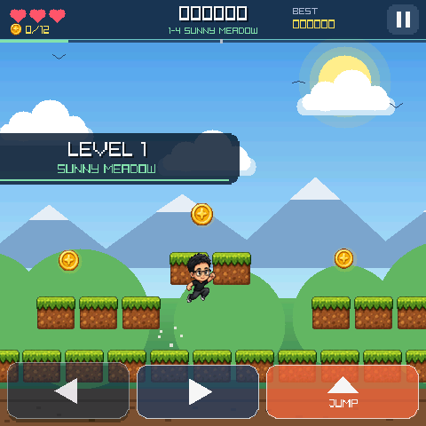

# Sky Hop

[简体中文](README.CN.md) · [Examples](../README.md)

Sky Hop is a four-level side-scrolling platformer. Collect coins, stomp patrolling enemies, bounce on springs and reach the flag at the end of each level; lives, score and coin-chain bonuses carry across levels, and clearing the fourth level finishes the run.

The four levels each have their own weather and palette: Sunny Meadow (birds), Storm Ridge (rain and lightning), Frost Peaks (snow) and Ember Crag (drifting embers).



The image is a Host RGB565 frame of the first level with its level banner.

## Play and controls

### Device

- Tap the title card to start, then release before controlling the hero. Resume gestures are also consumed until release.
- The two arrow buttons at the bottom move left and right, and the `JUMP` button jumps; a short press gives a hop, a long press a full jump.
- Movement and jump can be held together. Only the visible button rectangles respond; the ground and gaps between controls do not. Tap the top-right button to pause, then release and make a fresh tap to resume. Touch and keyboard are independent, so releasing one does not cancel the other.
- Button, joystick and IMU input map to the same game actions.
- Stomping enemies without touching the ground chains the reward: 250, 500, 1000, then 2000 points. After a hit the hero blinks and is briefly invulnerable.
- The HUD shows hearts, collected coins, score, best score, the level name and a progress bar. The first level teaches jumping over a safe step; its approach hint stays visible until you pass it, without requiring a dangerous pit crossing.
- Every event has its own chiptune cue and haptic pattern: jump, landing, coin, stomp, spring, checkpoint, hurt, level clear, game over and start. Levels 1 and 3 play the day theme, levels 2 and 4 the night theme, and music ducks while paused.

### Host

- `A`/`D` or arrow keys: move.
- `Space`: jump.
- `Enter`: start or go to the next level.
- `P`: pause or resume.

## Host preview

From the repository root:

```sh
python3 tools/game_cli.py sim examples/sky_hop
```

Host and device share the gameplay model, Camera2D world view and RGB565 drawing code; audio, physical input and LCD output still need device verification.

To preview a later level on Host, set `SKY_HOP_SIM_LEVEL` to 1–4, for example `SKY_HOP_SIM_LEVEL=3 python3 tools/game_cli.py sim examples/sky_hop`. Native builds ignore it.

## Implementation

The gameplay model (`platform_game.[ch]`) reports what happened each tick as an event bitmask. The view (`sky_hop_view.[ch]`) turns those events into particles, score popups, squash and stretch and screen shake; the feedback module (`sky_hop_feedback.[ch]`) turns them into sound and haptics. `game_module.c` only wires input and lifecycle. All objects have fixed capacity. The best score is kept only for the current session and is not saved.

`assets_src/generate_audio.py` synthesizes every effect and both music loops with numpy; the generated WAVs are not tracked in git. Native firmware embeds the packed assets in the application image.

## Native build

See [build paths](../../docs/build-matrix.EN.md) for targets, Board selection and standalone examples, and the [game development guide](../../docs/game-development.EN.md) for Host tests, fixed replay and device acceptance.
