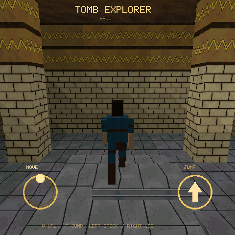

# Tomb Raycast

> 内测版本：保留在仓库中作为光栅负载与内部试玩，不进入 Registry 发布包和发布 CI。

Tomb Raycast 是 PS1 风格第三人称墓室探索游戏。五个房间通过传送门连接，场景包含斜坡、
高低差、雕带、墓室和水池。所有贴图均由本项目生成。



上图为大厅的 Host RGB565 画面。

## 玩法与操作

### 真机

- 在左半屏落指生成浮动摇杆，拖动角色移动。
- 在右半屏拖动，控制跟随相机的环绕和俯仰。
- 点击 `JUMP` 跳跃。

### Host

- `W`/`S`：前进和后退；`Q`/`E`：横移。
- `A`/`D`：环绕相机。
- `F`：跳跃。
- 鼠标左右区域沿用真机的摇杆和相机拖动规则。

## Host 预览

在仓库根目录运行：

```sh
python3 tools/game_cli.py sim examples/tomb_raycast
```

## 实现特点

Host 与真机共用 C 模型和透视校正纹理三角形视图。角色由低多边形盒体组成；房间、门户、
扇区高度和相机碰撞均由确定性模型驱动。

## Native 构建

构建目标和 Board 选择见[构建路径](../../docs/build-matrix.CN.md)。历史数据保存在
[历史真机记录](HISTORICAL_PERFORMANCE.md)，不代表当前版本的性能结论。
